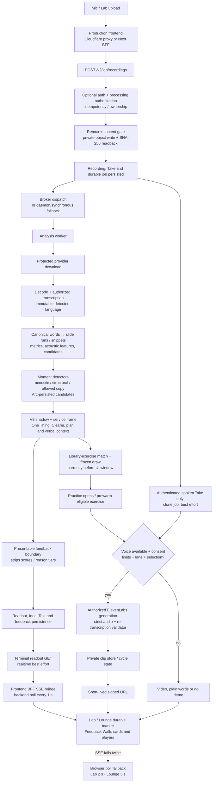
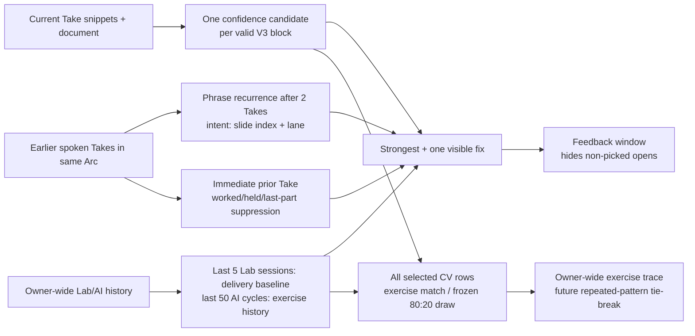

# The AI version of your voice — how it works

> **Label: Reference** · how something works today; where it differs from the In force docs, they win. Every doc and its label: [`README.md`](../README.md) (N106).

The lock (flow, words, rules) is
[`FOUNDER-LOCK-ai-voice-practice-2026-10-12.md`](FOUNDER-LOCK-ai-voice-practice-2026-10-12.md)
(decisions log N71). This page is for whoever runs or changes the code.

## The user flow

1. A speaker records a Take. As it is stored, beside its processing (founder
   2026-10-20, N84; before that, only when processing finished), one
   background job makes their AI voice (an ElevenLabs Instant Voice Clone)
   from the Take, once. A Take too short or too noisy makes none; the next
   Take tries again. The pipeline still asks at its end, and a voice already
   on its way is not asked twice.
2. In a newly baked V3 walk, the strongest moment is praise and is stored with
   `confident_practice=False`, so it does not create a new AI clip. The
   weakest eligible moment may be a **voice Exercise**. A Clearer version is
   not prewarmed because its accepted words do not yet exist; after the speaker
   accepts a rewrite, its `rewrite` practice lane may ask for a clip. Historic
   rows with `confident_practice=True` remain readable for compatibility; they
   are not the current bake rule.
3. The clip starts at the end of the bake (founder 2026-10-15, B): when the
   Manager's feedback block is stored, `ideal_text_feedback_bake` reads the
   voice-exercise moment from it (`ai_voice_clip.exercise_moment_of`, the
   walk's own rule) and queues `ai_voice_clip.prewarm` in the bake's lane
   (`BAKE_QUEUE_NAME`, else the pipeline queue), once per Take and moment.
   The prewarm opens the moment's practice server-side through
   `practice_start.start_practice` (the kind the walk would open: the
   offered exercise, else `plain`; the same purpose and consent checks as
   the routes) and runs the clip job. The walk's own ask
   (`POST …/confidence-practice/<id>/ai-voice`, when the Exercise screen
   opens if no video fits, or when Practise is tapped if one does) is the
   fallback: it resumes the same practice and finds the same cycle. One clip
   per practice, reused for every appearance; a clip that fails its check is
   made once more with a new seed, never a third time
   (`AI_VOICE_GENERATION_RETRIES`, 1; founder 2026-10-21, N93), and a failed
   one is never shown. A clip that is `unavailable` once its exercise was
   chosen (a failed check, the provider or the limits refused, no voice)
   still names `problem` and `phrase`, as a pending one does, so the One
   thing walk's fix says its tip in words without the clip (N370). While the job is queued or waiting for the voice,
   `demo` already says `ai_voice` with the clip `pending`, so the walk shows
   the clip's place. A voice not ready yet (the clone from Take 1 still
   being made) is asked for again every 30 s, at most 5 times
   (`generation_metadata.no_voice_waits`); after that the clip is
   `unavailable` (cycle `skipped`, `no_voice`) and a later ask with a voice
   on its way starts it again. A voice that will not come (the clone row is
   `none`, `failed` or off: a Take too short or too noisy to copy) is not
   waited for: the clip is `unavailable` at once, so the walk shows the
   locked Exercise rather than the dots. A speaker whose voice is turned
   off (the card's Delete, or `enabled` false on their row) is never
   offered a clip: the ask opens no cycle and answers with no clip.
4. The clip is shown in the video's place (no exact-fit video for the same
   problem), and after a try that isn't better yet, at most 3 times. It never
   plays by itself.
5. The next try is measured on the one problem practised and stored, only
   after a clip that was made (N93: a try after a failed clip used to be
   scored and could hold that problem back for the speaker). For
   fillers (founder 2026-10-18) the measure is hesitations per 100 words of
   the try's own transcript, against the same line as the pick.
6. Data & consent: Delete removes the voice at ElevenLabs and here, with every
   clip; Turn on makes it again from the next Take.

## The architecture (one job per module)

| Module | Job |
|---|---|
| `services/ai_voice_severity.py` | severity 0–1 per problem (pace, pause, stress, fillers) against the speaker's own usual; picks one or none; the target phrase; the next try's outcome |
| `services/ai_voice_prompt.py` | the structured exercise → one Eleven v4 request, words unchanged (the fillers clip leaves the hesitations out, nothing else), whitelisted tags only |
| `services/elevenlabs_client.py` | the five HTTP calls; errors by kind |
| `services/authorized_voice_provider.py` | every ElevenLabs call behind a processing permit |
| `services/ai_voice_validator.py` | decodes, clipping, silence, duration, words kept, the change really there |
| `services/ai_voice_clone.py` | the speaker's one voice: make, reuse, delete, turn on |
| `services/ai_voice_clip.py` | the lane, the video rule, the job, what the walk may know |
| `services/ai_voice_limits.py` | daily and monthly limits, fail closed: 3 clips a day and 20 a calendar month for each speaker (N188), the app's day, the month's credits, and no new voice while the plan's voice slots are full (`AI_VOICE_VOICE_SLOTS`, Starter's 10) |
| `services/ai_voice_store.py` | the two tables (migration 0462; 0475 admits the fillers exercise) |
| `services/admin_takes.py` | the admin Take view: each Take's clip, its outcome and the fillers rate before and after |
| `routes/v2/ai_voice.py` | the walk's routes and the card's routes |

## Verified end-to-end system of record — audit 2026-11-16

**Audit boundary.** The backend baseline was production
`d71d78f435fffa0e04e5508853da0f7dc5c28ee5`; the starting worktree revision
`c33f255e` differed from it only in documentation. The delivery client was
read-only inspected at frontend production
`e9a43ba7029391cc49959599965649531f5876e3`, not from a dirty checkout.
This describes repository-verified behavior. Whether a provider key, broker,
realtime transport, or authorization enforcement is enabled in a particular
deployment is configuration, not inferred here.

### Decision table A — intake, transcript, and evidence

| Decision / code authority | Signals, thresholds, and time window | EN / PL and privacy boundary | Output, persistence, fallback, and coverage | Verified failure mode / limitation |
|---|---|---|---|---|
| Upload admission — `routes/v2/lab_recording.py`, `lab_audio_intake.py` | Audio MIME/size validation and WebM remux precede admission. The request is resolved to its Project/Take and idempotency key before work starts. | The request carries media, not a user-controlled language choice. Authorization is separate from provider calls. | A valid upload enters the recording flow; duplicate idempotency reuses the accepted work. | A client disconnect can occur after persistence and before it sees the session id; it needs a reconciliation contract, not a blind retry. |
| Content gate — `min_content_gate.py` | Rejects no voiced audio. Config is `MIN_DURATION_SEC=0`, `MIN_VOICED_SEC=3`; effective voiced floor is `min(3 s, max(0.1 s, duration × 0.5))`. | No transcript-language assumption. | Only passing audio continues to private storage and analysis. | Very short recordings can pass a proportionally smaller threshold; this is intentional current configuration, not a quality guarantee. |
| Private audio persistence — `lab_recording_persistence.py`, `lab_audio_storage.py` | Object key is under `willab_lab/{session}/…`; write is verified by SHA-256 read-after-write before the Take/recording links settle. | User audio stays private; storage helper refuses a public URL. | Persisted recording/session plus orphan recovery record on a post-upload failure. | Object and database failures can leave recoverable orphans; no public-media escape hatch exists. |
| Processing authorization — `processing_authorization.py`, `authorized_provider.py` | Manager/authorization gate is evaluated per operation; provider permits are short-lived (15 minutes) and use hashed pseudonyms. | No route-local provider authorization; processing purpose controls protected download/transcription. | Typed permit or refusal; provider events are logged. | Runtime enforcement is deployment configuration and cannot be claimed from source alone. |
| Dispatch and recovery — `lab_analysis_dispatch.py`, `pipeline_jobs.py` | Durable job is queued after persistence. Broker failure can try daemon then synchronous dispatch. | Dispatch payload contains IDs/context, not raw bytes. | Job state plus compare-and-set reconciliation; downstream reads can poll terminal state. | A broker job may remain marked failed even when fallback analysis succeeds: high-value reconciliation decision, not patched in this audit. |
| Decode and transcription — `services/lab_recording.py`, `recording_transcription.py` | Worker applies recording clock offset and runs decode/transcription in parallel with clone prewarm where allowed. Word timestamps are required for canonical pieces. | `recordings.transcription_language` is persisted once when detected; `en` / `pl` are the supported AI-voice values. Unknown language is not silently treated as English by the voice path. | Canonical word/segment transcription and language field; segment-only provider response can exist but produces no timestamp-driven pieces. | Missing word timestamps can leave no canonical pieces; text-only recovery needs a product/evaluation decision. |
| Provider prompt construction — `openai_service.py` | English receives English filler/domain hints. Known non-English receives its language/vocabulary only. Unknown receives neither biasing hint. | UI locale is deliberately not a transcript-language override. | Provider transcription response, then immutable language persistence. | Legacy/manual paths that read an intake language remain an ambiguity risk outside the standard Lab path. |
| No-tap deck attribution — `slide_word_split.py` | A deck with no slide advances means the entire timed transcript belongs to opening slide 0. Timed words are bucketed by the slide on screen. | Language-neutral timed-word logic. | Per-slide transcript and canonical pieces agree; golden test covers full no-tap transcript on slide 0. | Historical all-empty persisted slide transcripts can be rebuilt dynamically in readout; new/retried work now persists correct slide 0 data. |
| Canonical piece construction — `recording_piece_analysis.py` | Chunks normal content around a target of 75 words (nominal 60–90); preserves timed slide runs and salience/budget processing. | Unicode transcript is retained; lexical fallback has an ASCII-only alignment weakness noted below. | Snippets/pieces and feature inputs are persisted and reused by feedback/readout. | Missing timestamps or faulty slide alignment can starve downstream moment selection even if a transcript exists. |
| Acoustic feature extraction — worker feature services | Pace, pauses, loudness/stress, transcript/filler evidence and candidate signals derive from canonical snippets. | Filler vocabulary is language-aware only when the immutable recording language is supplied. | Feature-bearing snippets feed V3 and AI-voice severity; raw numeric scores remain internal. | Feature error is evidence error: absence is not proof a speaker did nothing well or poorly. |
| Readout reconstruction — `readout_context.py` | Terminal readout loads persisted slide transcripts, then rebuilds from canonical words when those rows are missing. | Readout exposes a safe setup projection, never raw `session_context`. | Terminal response supplies readout, safe setup, and state; realtime is best effort. | Reconstruction protects historical no-tap rows but cannot manufacture absent timed-word evidence. |

### Decision table B — moments, patterns, and intervention assignment

| Decision / code authority | Signals, thresholds, context window | Priority and conflict resolution | Output / persistence / tests | Known limitation |
|---|---|---|---|---|
| V3 activation — `ideal_text_changes.py`, `take_feedback_policy_v3.py` | Builds a shadow frame from the current Take’s document, canonical snippets, candidates, feedback rows, plan, held words, verbal read, prior fixes and prior parts. | V3 service is allowlisted; unavailable V3 does not silently fall back to V2 except an explicit off switch. | Internal frame is sanitised before presentation; `candidate_score`, `reason_tier`, and degraded reasons do not leave the service. | A feature missing from the current Take reduces evidence; it must not become a fabricated diagnosis. |
| Coverage gate — V3 policy | Required semantic coverage: Take 1 `70%`, Take 2 `80%`, Take 3+ `100%`; ordinary blocks target 75 words and are normally 60–90. | Uncovered blocks cannot be selected as if fully assessed. | Frame/block selection records selected moments and exclusions; unit policy fixtures cover frame behavior. | Sparse or timestamp-less evidence can make feedback too thin rather than safely specific. |
| Presentable moment gate — `_showable`, `_moment_read` | A candidate needs a usable snippet/clip and presentable context; praise/green/unmarked exclusions apply. | One shown moment per block after scoring/servability filters. | Moment fields drive text response and practice creation, with raw scores stripped at boundary. | The exact statistical calibration of upstream candidates is not independently validated by these policy tests. |
| Strongest / praise — `_mark_moments` | The strongest selected moment is a confidence anchor; V3 writes `confident_practice=False`. | Strongest praise is kept even when one-fix selection chooses a different weak moment. | Praise feedback and card text persist; current V3 test/data has no new praise clip. | Historic `confident_practice=True` rows remain reachable compatibility behavior and make old comments appear contradictory. |
| Exact One Thing priority — `moment_pick`, V3 policy | Candidate reads combine presentability, semantic evidence, verbal weighting, rewrite eligibility, voice eligibility and context. | The picker establishes strongest/praise, then verbal-weighted Clearer, then weak voice, then words-only Clearer. The One Thing resolver is `Sniper tempo → plan-level → Clearer → weakest voice`; a failed/missing Clearer can use only that moment’s voice backup, otherwise the fix is removed. | Only the selected family/moment reaches the client feedback contract; other non-strongest shown blocks are retired. | Legacy `manager_engine` arbitration is not the current V3 Take-contract path; do not infer its PPV/cooldown/budget ordering into V3. |
| Weakest / voice — `_voice_problem`, `ai_voice_severity.select` | Requires sound, at least 8 words, non-held/non-worked context, and severity `>= 0.2`. Severity is Take-local: pace, pause, stress, fillers versus the speaker’s own snippets. | Deterministic problem ties rank `pace`, `pause`, `stress`, `fillers`. One-fix path uses strongest measurable problem, no explore/default/holdback. | Weakest `voice` moment/prompt may be persisted and open `exercise`/`plain` practice. Golden fixture now verifies Polish `yyy` changes this eligibility only under frozen `pl`. | Severity is relative to a single Take, not a population norm; few snippets make the “own usual” median weak. |
| Language parity fix — `ideal_text_changes.py`, V3 policy | V3 receives `recordings.transcription_language` through a field-only batch read. Explicit missing/unsupported language withholds voice. | Live V3 and later voice generation now use the same immutable language. Legacy/offline callers that omit the field retain their historical English fallback. | Regression fixture: `tests/test_take_feedback_policy_v3.py::test_polish_filler_voice_fix_uses_the_frozen_recording_language`. | This is only `en`/`pl`; unsupported language is fail-closed for voice rather than guessed. |
| Filler evidence — `transcript_smoothing.py`, severity service | PL clear fillers include `yyy`, `eee`, `em`; contextual items such as `jakby`, `wiesz`, `znaczy`, `no`, `więc` are deliberately conservative. | A language-specific count may create a filler intervention only after the severity gate. | Filler clip removes filler tokens from the spoken sentence; validator rejects a clip that re-hears them. | Polish discourse words are ambiguous; conservative counting reduces false positives at the cost of false negatives. |
| Clearer rewrite — rewrite gate / V3 policy | Candidate must be a shown word issue, pass rewrite gate, respect declined rewrite keys and current context. | One Thing picks strongest praise + one fix; Clearer can win when its rewrite passes. A `voice_too` backup exists only where a measured voice problem can reach the user if rewrite cannot. | Accepted rewrite persists and can later open `rewrite` practice. | Acceptance is user-contingent, so no Clearer AI clip can be prewarmed from unknown words. |
| Plan / Sniper / tempo | Plan level, key line, held words, context, tempo step and verbal read are inputs to the same frame. | Sniper tempo is first in the One Thing resolver; plan-level is next, followed by Clearer then weakest voice. | Plan and moment state persist in their own services; text route remains Manager-gated. | These controls add interaction complexity; only a deliberately designed experiment should change their precedence. |
| Prior fixes / worked suppression | `held_words`, last fixes and last parts suppress a repeated or already-worked correction. AI exercise history can record a problem held back after two non-improved outcomes. | One Thing does not keep teaching the same successful/held point by accident. | History survives across takes for the speaker/arc contexts used by the policy; practice outcomes feed future selection. | This is stateful evidence, not causal proof that an intervention caused a change. |
| Across attempts and projects | Phrase recurrence, decision/intent suppression and last One Thing/worked history use spoken sessions in the Arc; protected phrases become protected after 2 Takes and intent key is `(slide_index, lane_class)`. Voice-confidence baseline reads the user’s last 5 Lab sessions without an Arc filter; exercise-matching history is owner-wide (excluding current Take), with repeated pattern at 2+. | Current-Take evidence chooses the moment, while history is deliberately mixed-scope: phrase/project memory is Arc-scoped, delivery/exercise personalization is speaker-wide. | Rows remain keyed to Take/session/arc/project relationships; no Phase-2 model-learning activation was found. | Whether speaker-wide delivery history should cross projects is a founder/science decision, not a safe schema or policy change. |
| No clear problem | For a Clearer/rewrite selection, default stress may be used where allowed. For One Thing fix, `allow_default=False` means no measurable problem → no clip. | V3’s text intervention can remain available even when voice selection has none. | `skipped/no_exercise`, text-only or no intervention according to context. | A default exemplar is a product choice, not evidence that delivery was wrong. |
| Manager / coach separation | Feedback is built from structured evidence and persisted feedback rows; coach layer remains blind to raw speaker numerical verdicts. | Manager gate controls feedback release; AC-9 prevents raw scores/numeric verdicts reaching speaker. | Text/card routes disclose only curated text, problem/phrase/passage where permitted. | Generated claims still need a semantic-evidence evaluation; gatekeeping does not prove wording accuracy. |

### Pattern lineage — what accumulates, where, and what it can change

| Pattern store / source | Exact accumulation and scope | What it changes | Reliability and drift risk |
|---|---|---|---|
| V3 confidence candidates | V3 chooses one confidence candidate for each valid block before moment/window selection. It emits selected rows rather than only the eventual shown rows. | Supplies matching/moment material and can initiate exercise matching. | Candidate selection is richer than visible feedback by design; do not equate selection with exposure. |
| Visible moment window | Moment picking limits feedback to strongest plus one fix; the later window leaves unpicked open moments hidden and does not replace an answered moment. | Determines the actionable Walk/card experience. | UI visibility occurs after current exercise attachment, producing the hidden-assignment inconsistency documented below. |
| Library exercise assignment | Active published exercise with explanation video; reliable audio needs ≥2 s, audio ref, voiced ratio `.32–.99`, no explicit unreliable/noise-dominant flag. Match precedence is exact main target, then trial secondary; frozen 80/20 draw key is `(take_session_id, snippet_id, exposure_policy_version)`. | Carries exercise/video metadata and creates match trace. | V3 admits `weak_acoustic_evidence` if a weak machine read and observed tag remain; precision must be measured, especially low-ASR-confidence Polish clips. |
| Exercise recurrence history | Owner-wide history excluding current Take; repeated pattern needs at least 2 distinct earlier Take IDs and is only a matching tie-breaker. Current query limits rows, despite `HISTORY_TAKES=20` wording that says Takes. | Ties favor repeated, not-completed-before patterns. | A verbose recent Take can consume the row budget and hide older distinct Takes. Scope/row-vs-Take unit needs a product decision. |
| Arc phrase and intent memory | Protected phrase collection reads spoken Arc sessions and protects recurrence after 2 Takes. Intent ledger key is `(slide_index, lane_class)`. | Suppresses redundant phrase/candidate treatment within the Arc. | Arc/project scope is intentionally narrower than speaker delivery history. |
| Immediate-prior Take / worked suppression | Only immediately prior completed spoken Take in the Arc; checks current numeric slide index, last fix and last talk part. | Avoids repeating a correction that worked on that slide and downweights repeat parts. | Replacing a deck in the same Project can reuse slide index for unrelated content; title/deck identity is not included in this lineage. |
| Voice-confidence baseline | Reads the user’s last 5 Lab sessions without an Arc filter; sparse confidence handling requires cue/sample evidence. | Adds delivery baseline and selects delivery candidate evidence. | Cross-project personalisation may be intended but needs founder/science confirmation; weights are provisional/un-calibrated. |
| AI-voice exercise history | Reads owner’s latest 50 cycles; two latest ready non-improved cycles can hold back a problem for normal rewrite/exploration selection. One Thing fix intentionally disables holdback. | Shapes later AI-voice choice, not current raw feedback. | Owner-wide/language/project carry-over is a product choice, not a user-authorization leak. |
| Legacy versus V3 rollback | Legacy candidates are built first; when service is enabled V3 owns final rows, including typed no-row failure. V2 remains the explicit rollback when `MLC3_SERVICE_ENABLED` is off. | Determines which contracts/matching pipeline is active. | Old “sole manager gatekeeper” descriptions are stale for V3; legacy manager arbitration must not be claimed as V3 precedence. |

The language field contract is shared by the whole generation/check job:
`recordings.transcription_language` is the frozen source and currently must be
`en` or `pl`. The job passes that code unchanged to ElevenLabs
`language_code`, Whisper re-transcription, Unicode word/phrase matching,
filler removal and checks, severity selection, and every generation retry. A
missing or unsupported value is a `configuration` failure; a returned clip
whose words or exercise do not pass the strict validator is a `validation`
failure. Synthetic tests may carry the same field on the practice payload;
they never use provider keys or personal audio.

Job states (`ai_voice_cycles.status`): `pending → analyzing →
choosing_exercise → generating → validating → completed | failed | skipped`.
Provider failures and validation failures are told apart in `failure_kind`.
Latency is in `latency_ms`: each stage (`choose_exercise`, `generation`,
`validation`, `store`), the job's `total`, and end to end: `since_request`
(the walk asked for the clip → clip ready, what the speaker waits) and
`since_take_saved` (the Take finished processing → clip ready).
Provider retries are counted in `generation_metadata.provider_retries`.

The severity minimum (`AI_VOICE_MIN_SEVERITY`, 0.2; 0.4 is the line itself) and every
normalization range (`AI_VOICE_PACE_*`, `AI_VOICE_PAUSE_*`,
`AI_VOICE_STRESS_GAP_DB`, `AI_VOICE_FILLER_GAP_PER_100`) are environment
settings; see `config.py`.

**Fillers** (founder 2026-10-18, lock section "Decided after the lock,
fillers"): the hesitations counted are the closed, recording-language list
the transcript fence removes (`services/transcript_smoothing.py`). The lane
speaks and is re-heard in the persisted recording language. The sentence sent is the speaker's own
with those tokens left out (`ai_voice_prompt._without_fillers`); the
validator refuses the clip if one is heard (`fillers_heard`). The sentence
under the player is L18. The library has no fillers exercise, so an otherwise
eligible filler selection normally prefers the AI lane; availability, permit,
limit, provider, and validator failures still fall back to text/video/none.

When nothing reaches the minimum, a clearer version's example still
comes: the default is stress, the main point said so it stands out (founder
2026-10-15, A). The selection says `default: true` and `reason:
no_clear_problem_default`, so the stored cycles never count it as a problem
found. A sentence of under five words has no main point apart from itself
and gets no clip.

**The walk's one fix** (founder 2026-11-03, N425, "go for A, B and C"): the
One thing walk gives the AI clip only to a moment whose own clip shows a
problem at the minimum, the strongest of them (`moment_pick._weakest` reads
each clip's severities against the Take's own usual, the same
`ai_voice_severity.severities`). Its clip (`ai_voice_clip._choose`, a
practice that is not a clearer version's, on a plan too) asks `select` with
`explore=False`, `allow_default=False` and `hold_back=False`: it teaches
that strongest problem by its own severity, never the runner-up, and with
nothing measured no clip is made (the cycle is `skipped`, `no_exercise`).
A problem the speaker has not improved on twice is still recorded
(`held_back`), but no longer gives way. On a plan the week's level's
problem still wins where the clip shows it (G7); where it does not, the
clip is chosen as off a plan. Exploring (`AI_VOICE_EXPLORE_SHARE`) and the
hold-back now only touch a clearer version's example.

### Exact AI-audio eligibility by intervention

| Intervention or practice | Gets a newly generated AI-voice clip? | Exact rule and reason | User-visible fallback |
|---|---|---|---|
| Current V3 strongest praise / confident moment | **No.** | `_mark_shown` stores `confident_practice=False`. Praise remains a text/card confidence anchor, not a new clip trigger. | Praise text/card only. Historic rows with `confident_practice=True` remain compatibility-read only. |
| One Thing weak `voice` fix | **Potentially.** | Must have sound, `>=8` words, a non-held/non-worked moment, severity `>=0.2`, frozen valid recording language, an allowed `exercise`/`plain` lane, voice availability, consent/authorization, capacity, provider success, and validator success. The fix selector disables explore/default/holdback. | Coach/exact-fit video wins when applicable; otherwise pending marker, then spoken tip plus video/plain/none if unavailable. |
| Clearer version | **Only after the rewrite is accepted and its `rewrite` practice opens.** | The original bake cannot prewarm unknown accepted words. `rewrite` is a voice lane, and rewrite selection may use exploration/default/holdback under normal clip rules. | The rewritten text still appears; unavailable voice remains text/video/none. |
| Ordinary own-words practice (`plain`) | **Potentially.** | `plain` is one of the three allowed voice lanes and otherwise follows the same authorization, availability, limits, selection and validation gates. | Normal practice copy/video/none. |
| Coach-selected or exact-fit library exercise video | **No displaced AI clip.** | `demo_for` keeps a coach-chosen video. It also keeps an exact library video when its main target intersects the selected problem (pace/pause targets fit `rushing`). | The video remains the exercise demo. |
| Filler exercise | **Usually yes if all general gates pass.** | Library targets do not cover fillers, so no exact video normally wins; selection uses the frozen EN/PL filler vocabulary and generation removes counted fillers from the spoken sentence. | Text tip; no clip if voice/permit/limit/provider/validator fails. |
| Sniper / tempo / One Thing Clearer-or-keep interaction | **No separate AI-audio entitlement.** | These are policy/text actions, not independently admitted voice lanes. The production client deliberately does not start clips for One Thing Clearer/keep practice. | The selected textual intervention remains visible. |
| Guest, read-only, replay flow | **No.** | The production client does not create AI-voice practice in those flows; backend routes also require authenticated purpose/consent. | Existing card/text/video behavior only. |
| Unsupported/missing recording language | **No.** | Voice generation and live V3 voice eligibility fail closed rather than guessing English. | Text/video/none; configuration failure is recorded for a started cycle. |
| Disabled/deleted voice, allowlist/consent/permit/limit refusal, failed provider or validator | **No ready clip.** | `ensure` and generation enforce availability, routes enforce purpose/consent, limits fail closed, and audio must pass re-hearing/quality checks. | `unavailable` changes an `ai_voice` demo to video if one exists, otherwise none; words remain available where a selection exists. |

### Decision table C — AI voice, persistence, and UI delivery

| Decision / code authority | Conditions, bounds, and lifetime | Privacy / language / priority rule | Persisted or delivered output | Fallback and coverage |
|---|---|---|---|---|
| Clone startup — `routes/v2/lab_recording.py`, `ai_voice_clone.py` | Best-effort clone work is started for an authenticated spoken Take. Sample requires 30–150 seconds voiced audio and at least 15 dB range. | Clone creation is separate from transcript/feedback provider authorization; deletion and turn-off are explicit. | One speaker voice record or typed none/failed result. | A too-short/noisy Take simply has no clone; processing and feedback do not fail. “Uploaded Take” wording remains a founder privacy decision because storage calls these `audit_upload`. |
| Allowed lanes — `ai_voice_clip.in_voice_lane` | Only `exercise`, `plain`, and `rewrite`; missing kind is treated as legacy `exercise`. | Lane test is independent of text intervention labels. | Eligible practice can create/reuse one cycle. | Anything else returns normal video/none without invoking ElevenLabs. |
| Practice start/prewarm — `prewarm`, `practice_start` | At most one cycle per practice; V3 bake prewarms the eligible exercise moment, not an unaccepted rewrite. | Same purpose/consent checks apply server-side and in routes. | Cycle reused on later asks, preserving a single practice result. | Prewarm failure is non-blocking; later user request resumes/creates the allowed cycle. |
| Voice availability and limits — `ai_voice_clone.py`, `ai_voice_limits.py` | Default caps: 3 clips/day/speaker, 20/month/speaker, 30/day total, 3 clones/day, 10 voice slots; 600 chars; 45-s practice. | Key, global enablement, allowlist, consent, ownership/purpose and capacity all gate calls. | Refusal is a typed cycle outcome / no clip. | Fail closed; a text/video fallback preserves the walk. |
| Exercise selection — `_choose`, `ai_voice_severity.py` | Minimum severity `.2`; pace/no-median comfort 155 and line 175 WPM; pause floor `.08` plus gap `.06`; stress gap 4 dB; filler gap 5 per 100 words. | Medians are speaker-relative within the Take. Tie order is pace → pause → stress → fillers. One Thing uses no explore/default/holdback; rewrite can use them. | Stores selection, before metrics, language and target passage/problem. | No measurable One Thing problem gives `skipped/no_exercise`, not a speculative clip. |
| Provider isolation — `authorized_voice_provider.py`, `elevenlabs_client.py` | Every remote action is wrapped in a typed permit and audit event. | Provider receives only authorized clip-generation inputs; routes do not call it directly. | Cycle state distinguishes provider, validation, configuration and internal failures. | Typed failure cannot block the primary feedback/readout flow. |
| Prompt and generation — `ai_voice_prompt.py`, `_make` | Max 600 characters; exercises use controlled delivery tags, not free-form speaker diagnosis. | Frozen `en`/`pl` governs provider language code, target parsing and filler removal. | Private MP3/object and selected problem metadata. | Provider errors/limits become unavailable; no provider URL is exposed. |
| Validator — `ai_voice_validator.py` | Rejects clipping `> .001`, silence share `> .45`, dead air `>1.6 s`, duration outside `.6–2.2×`/17 s, word error rate `> .10`, pace `.70–.97`, pause `.3–1.5` s/median 1.8, stress outside 1.5–10 dB. | Re-transcription and phrase matching normalize Polish diacritics/Ł; clip must apply the intended change. | Only valid clip reaches completed state and storage key. | Failed validation is retried once by default and never played. |
| Clip state and signed media — `ai_voice_clip.state` | Cycle progresses pending → analyzing → choosing → generating → validating → completed/failed/skipped. Signed URL lasts 900 seconds. | No raw audio is public; state reveals only safe `demo`, state, duration, problem/phrase/passage. | `ready` has signed URL; pending has no URL; play event may be recorded. | Sign failure becomes `unavailable`, never a broken player. |
| Terminal readout response — `lab_recording.py`, `user_sessions.py` | Only terminal built-readout responses carry the safe setup alias. | `setup` is an echo of already authorized `readout.setup`, not raw session context and not an additional DB read. | `{readout, setup, state}` for guest/authed paths; access control remains route-specific. | Processing/error responses retain their existing contracts. Contract tests cover both routes and absence when no nested setup exists. |
| Realtime and GET delivery — backend + frontend production `e9a…` | Backend emits realtime best effort; frontend BFF polls backend every 1 s to produce SSE deltas, heartbeat 15 s, closes at 55 s. | Browser receives safe readout envelopes only. | Immediate GET plus SSE subscriptions; terminal `ready`, `readout_ready`, `failed`, `failed_ideal_text_unconfirmed`. | After two failed SSE connections, browser polling falls back to 2 s in Lab and 5 s in Lounge. |
| Durable handoff — production `LabOverlay` / `Lounge` | Lab writes durable processing marker; Lounge reconciles it every 500 ms and on storage events after Lab closes. | Marker is UI recovery state, not new analysis authorization. | Settled readout creates paired Feedback Walk bubble and Ideal Text card. | Three-minute Lab messaging says recording is safe; a 504 without session id offers Back only to avoid duplicate upload. |
| Feedback cards and original audio | Feedback card loads `/v2/explore/arc/:arcId/feedback`; summary card has original key-moment audio. | Original recording/key-moment audio is distinct from synthetic AI voice. | Coach text, original span player, transcript/Ideal Text cards. | Missing/error feedback shows a calm “still putting this feedback together” state. |
| AI playback UI | Production client stores practice ID/time/fallback, never signed URL; pending bubble polls every 5 s up to 10 minutes. | User-initiated playback only; expired/broken URL is discarded and fetched once again. | `ready` player, pending typing marker, unavailable plain fallback. | Video suppresses AI waiting; One Thing keeps words visible after 10 s so late audio does not replace an active try. |

### Audit findings: stale, duplicated, and intentionally unreachable paths

| Finding | Repository evidence | Disposition in this audit |
|---|---|---|
| No-tap transcript split contradicted the product contract | `_bucket_words_by_slide` returned empty buckets without advances while canonical timed pieces already placed words on slide 0. | **Fixed and covered.** New golden makes full transcript and canonical pieces agree on slide 0. |
| V3 filler choice could disagree with later voice generation in Polish | V3 defaulted severity to English while `_choose` resolved frozen recording language. | **Fixed and covered.** V3 receives the field-only immutable language and fails closed when unavailable. |
| Frontend restore field was nested but client reads only top level | Production frontend `e9a…` maps only `body.setup`; backend already derived safe `readout.setup`. | **Fixed and covered.** Terminal routes echo only the already-authorized projection. |
| V3 assigns exercises before feedback-window visibility is known | V3 selects one Confident Voice row per eligible block; practice offers attach before `_window`, which can hide all but the selected open moment. Hidden assignments can enter owner-wide exercise history. | **Not patched.** This can distort recurrence, but moving/gating it changes product history semantics. Add a multi-block golden only after deciding whether an assignment/history entry must be UI-visible. |
| Bare slide-index continuity survives a deck replacement | Same-Project deck replacement can preserve take history while progress compares only numeric `slide_index`; an unrelated new slide 0 may inherit “worked” status. | **Not patched.** Decide reset-on-deck-revision versus title-map continuity, then add a same-index/different-title fixture. |
| `HISTORY_TAKES=20` is implemented as 20 rows | V3 can create multiple assignments per Take, but database history query applies `.limit(20)` to rows. | **Not patched.** Confirm whether the unit is assignments or distinct Takes before changing historical recurrence semantics. |
| V3 relaxed exercise evidence gate has no bilingual precision evaluation | A weak machine read + observed tag can carry an exercise without legacy high-pace/two-signal eligibility; low ASR confidence can map to word compression. | **Not patched.** This is an intentional accuracy dial that requires stratified EN/PL evidence before tuning. |
| Moment total can exceed its documented max | The acoustic loop obeys `MOMENT_SUGGESTIONS_MAX_PER_TAKE`, then congruence/delivery and structural append later. | **Not patched.** Founder must choose a global cap versus independent lane budgets/ordering before truncating potentially useful candidates. |
| V3 Confident Voice card can lack playable original audio | Canonical/legacy gate expects a playable interval; V3 service lineage gate does not require `snippet_audio_ref`, and playback is best effort. | **Not patched.** Decide whether to reject/no-card or allow a visual card without player; preserve current no-crash behavior meanwhile. |
| V3 `None` applicability has two incompatible descriptions | Runtime-on `None` yields failed/no rows; older helper wording describes outside-service/legacy fallback. | **Documentation/rollout debt.** Do not re-enable a silent V2 fallback without an identity/migration review. |
| “Praise and Clearer never call ElevenLabs” and “frontend isn’t built” | Both statements conflicted with current rewrite lane/frontend implementation. | **Documentation fixed.** Current V3 praise is no-clip; accepted rewrites can use a lane; deployed client exists. |
| `split_words_by_slides` is not a normal runtime path | It is an older no-timeline helper; canonical timed splitter is used in live recording analysis. | **Retained.** It is compatibility/maintenance debt, not safely removable without caller/fixture migration. |
| Processing-stage vocabulary is not the same as feedback lifecycle | `processing_stages.derived_state` has no recorder; `manager_selection`/`exposure` are written later in the feedback path. | **Not changed.** Treat progress labels as operational, not an end-to-end proof; align ledger/vocabulary with a reviewed migration. |
| Frontend comments say later takes are locked | Production backend serves spoken takes with `locked: false`; mapper handles it correctly. | **Document as explanatory drift.** No behavior change. |
| Historic praise clip compatibility looks like a live rule | `practised_moments_of` can read historic `confident_practice=True`, while current V3 writes false. | **Retained compatibility.** Do not delete persisted-data support without migration/replay evidence. |
| Legacy documentation describes V3 as dark or Manager-only | The V3 service actively owns final rows when enabled; older policy/module/Appendix descriptions are legacy Reference material. | **Not changed beyond this verified record.** Reconcile labelled legacy docs under the normal founder/document process. |

### Accuracy and safety risks to evaluate, not guess away

| Risk | How it can be wrong | Existing mitigation | What remains to validate |
|---|---|---|---|
| False positive delivery feedback | Feature noise, a small Take-local median, or selection precedence can label a normal variation as a fix. | Minimum severity, word/sound/context gates, held/worked suppression, one-fix cap, no raw score disclosure. | Blind human-label agreement stratified by problem, Take length and language. |
| False negative delivery feedback | Missing timestamps, conservative thresholds, no median, or strict server gates can suppress a real opportunity. | Text/clearer can still exist without a voice clip; no default voice fix in One Thing. | Measure coverage and missed-opportunity labels; decide whether a safe text-only recovery is warranted. |
| Polish filler ambiguity | `no`, `więc`, `wiesz`, etc. can be discourse content rather than hesitation. | Closed/conditional PL vocabulary; explicit language frozen from recording; `yyy`/`eee`/`em` clearer. | Bilingual, human-annotated filler fixture set; report precision/recall separately for clear vs contextual tokens. |
| Transcript uncertainty | Provider words/offsets may be wrong yet look structurally valid. | Protected provider path, canonical word requirements, validator re-hearing for synthetic clips. | Store confidence/uncertainty calibration and test low-confidence/noisy audio decisions. |
| Temporal/slide misalignment | Clock offset, lost taps or ASCII-only lexical fallback can attach words to wrong slide/moment. | Timed slide runs; no-tap slide-0 parity golden; readout reconstruction. | EN/PL slide-alignment gold corpus including diacritics and late/absent taps. |
| Sparse evidence | One short clip cannot robustly establish a speaker’s usual pace, pauses, or stress. | Take-local medians require enough rows; stress has no score without a median. | Minimum-evidence experiment vs user-perceived relevance; do not add cross-project profile silently. |
| Invented or over-specific claim | Generated text can overstate what the measured signal supports. | Manager gate, structured evidence, signed line bank, AC-9. | Claim-to-evidence review set with severity-blinded raters; reject unsupported causal language. |
| Intervention mismatch | V3 selection, practice lane, video selector and client eligibility can choose different modalities. | Current Polish parity fix; one shared selection path for One Thing; safe state contract. | Contract tests spanning policy → practice → `demo` → client state for every intervention family. |
| Language mismatch | Old/offline callers may default English; unsupported language cannot safely use EN/PL voice rules. | Live path field-read/fail-closed; provider/validator uses frozen language. | Instrument unknown/missing language rate and investigate source before expanding language support. |
| English-only generated rationale | Current signed `WHY` strings, including the filler line, are English even when the clip is Polish. | The underlying clip language is frozen correctly; text is bounded and no raw score is disclosed. | Founder-approved PL copy/localization and bilingual comprehension review. |
| Invisible practice history | A hidden V3 moment can receive an exercise assignment before feedback windowing, then influence owner-wide exercise history. | UI does not show the hidden offer, so it does not directly pressure the speaker. | Decide visibility-before-history semantics and test a 10-block windowed scenario. |

### Ranked morning decisions (not implemented)

| Rank | Recommendation and repository evidence | Expected impact / confidence / effort | Validation experiment | Founder decision needed |
|---|---|---|---|---|
| 1 | Reconcile broker-failure job status after daemon/synchronous fallback. `lab_analysis_dispatch` can complete work while durable job remains failed. | High recovery reliability; high confidence; medium effort. | Fault-inject broker refusal, then assert one terminal truth in readout/job ledger and no duplicate analysis. | May a failed immutable job be superseded, or may its status be reconciled in place? |
| 2 | Build bilingual EN/PL slide-alignment and filler-evaluation gold fixtures. ASCII lexical fallback and contextual Polish fillers are known uncertainty points. | High accuracy/safety; high confidence; medium effort. | Blind annotation of word/slide, filler and intervention relevance; report precision/recall by language and noise/tap condition. | Approve the target quality bars and consented evaluation data source. |
| 3 | Decide whether V3 exercise assignment/history requires a UI-visible practice offer. Current ordering can persist hidden assignments and influence speaker-wide matching history. | High intervention-integrity impact; high confidence; medium effort. | Multi-block golden: select 10 valid blocks, window one fix, assert chosen semantics for offers/history. | Choose “visible only” versus “internal assignment counts” and retention/migration behavior. |
| 4 | Define recovery for frontend BFF timeout/abort after backend persistence. Production frontend can lose a session id and call it discarded after persistence. | High user trust/recovery; high confidence; medium-to-high effort. | End-to-end disconnect at each upload phase; measure recoverable marker/session outcomes and duplicate risk. | Choose idempotency/resume UX and whether accepted-but-unacknowledged takes surface automatically. |
| 5 | Instrument and remediate missing timestamps / empty slide-transcript persistence. | Medium-high feedback coverage; high confidence; medium effort. | Dashboard rates of segment-only transcriptions, no-tap reconstruction, empty slides, and final readout availability. | Decide whether a text-only non-moment fallback is allowed when timestamps are unavailable. |
| 6 | Resolve whether “uploaded Take” includes every Lab recording for AI cloning. Docs say no; persistence labels it `audit_upload`; clone path accepts authenticated spoken Takes. | High privacy/product clarity; medium confidence; low implementation once decided. | Privacy review plus a consented scenario matrix (mic, browser upload, imported file, guest). | Define allowed sources for cloning and consent wording; do not change code before this. |
| 7 | Define continuity after a deck replacement. Current worked-fix suppression compares bare slide index within an Arc. | Medium-high relevance accuracy; high confidence; medium effort. | Same-Project deck replacement fixture with same index/different title, then compare reset vs title-map semantics. | Choose reset-on-deck-revision or explicit title-mapped continuity. |
| 8 | Confirm whether recurrence history is owner-wide and whether its window means assignment rows or distinct Takes. | Medium cross-project relevance; high confidence; medium effort. | Two-project fixture plus many-row/recent-Take fixture; measure repeated-pattern match differences. | Approve speaker-wide transfer and the intended history unit. |
| 9 | Decide the global moment-cap and playable-audio-card contracts, then update stale V3/manager applicability descriptions. | Medium feedback consistency; high confidence; low-medium effort after decision. | Candidate-count and no-audio-card evaluation across legacy and V3 scenarios. | Choose global cap vs lane budgets; choose reject/no-card vs visual card; approve a migration/deprecation window. |
| 10 | Align processing-stage/feedback lifecycle vocabulary and remove only proven dead compatibility paths. | Medium operability; high confidence; low-medium effort. | Trace tables and alert tests across queue/retry/readout; confirm zero callers before removal. | Approve a migration/deprecation window for persisted historic rows. |

## What Eleven v4 can and cannot do

No SSML; no `speed` or `style` on v4 (only `stability` and
`similarity_boost`). So pace is asked for with `[slowly]` and clause breaks,
the pause with `[pause]`, stress with capitals (the one documented way;
there is no emphasis tag), and fillers by sending the sentence without them. Tags guide delivery and are not guaranteed, so
**the validator decides**: a clip that didn't apply the change is never shown.
Stress is the least reliable of the three; measure it in the smoke test.

## Environment

Put these in `.env` locally and on **every** Railway service (web, worker,
cron) before merging (CONFIG-FIRST): `ELEVENLABS_API_KEY`. That's all: the
feature is always on for every speaker once the key is there, and does nothing
without it. `AI_VOICE_ENABLED=0` is only an emergency off; `AI_VOICE_ALLOWLIST`
(user ids) optionally narrows it. The rest have defaults; see
`.env.example`. The key is never logged and never sent to the frontend.

## Local testing

- `bash scripts/local_ci.sh` runs `tests/test_ai_voice.py` with the rest.
  No real audio, no real provider.
- The manual smoke test, with your own consented voice and the real account:
  `scripts/ai_voice_smoke.py --sample <your file> --i-consent-this-is-my-own-voice`.
  It writes the three clips and a report next to the sample and deletes the
  clone afterwards.

## Measured prototype latency

One run, the founder's own consented voice, on their laptop, 2026-10-13
(`scripts/ai_voice_smoke.py`, Eleven v4, the default sentence, Whisper
re-hearing the clip). Milliseconds. A prototype's numbers on one voice and
one sentence, not a real-time claim.

| exercise | generation | re-transcription | validation | end to end | passed |
|---|---|---|---|---|---|
| pace | 8,853 | 4,356 | 3,990 | 17,203 | yes |
| pause | 1,978 | 879 | 66 | 2,925 | no: `pause_length`, `pause_not_distinct` |
| stress | 1,707 | 2,224 | 64 | 3,997 | yes |

- The pace row is the run's first clip: its generation and validation
  include cold starts (the first provider connection, the audio decoder's
  first load). The later clips took 3 to 4 s end to end.
- Second run, same day (ellipsis before the `[pause]` tag): pace 10,888 ms
  end to end (8,574 generation, 2,127 re-transcription, 183 validation),
  passed; pause 3,913 ms, failed; stress 3,275 ms, passed. The test clone
  was deleted and confirmed gone.
- The pause clip had a clearly audible pause (the founder listened; the
  audio held a 1.24 s silence), but Whisper's word times showed no gap at
  all: they stretch the words over short silences. The check now reads the
  pause from the audio's silence around the target phrase.
- Third run (2026-10-14): pace 10,825 ms end to end, passed; stress 3,023 ms,
  passed; pause 3,803 ms, now distinct but 1.24 s long, over the 1.2 s
  limit. The limit is now 1.5 s (still under the 1.6 s dead-air limit).
- In the app the job also waits on the queue and stores the clip; the walk
  shows the breathing mark meanwhile (`latency_ms.since_request`).
- The run's delete of the test clone was reported as refused: ElevenLabs
  answers a missing voice with a 400 `voice_not_found`, which the client
  now reads as already deleted.

To measure again:

    .venv-ci/bin/python scripts/ai_voice_smoke.py \
        --sample <your own sample> --i-consent-this-is-my-own-voice

## Known limitations

- **Permits.** ElevenLabs calls run as `feedback_generation` with provider
  `elevenlabs` until counsel sets a dedicated purpose (then one migration of
  the permit function), before launch.
- **Practice tries over 45 s** are not rejected by the existing attempt route;
  the AI voice simply doesn't measure them (`inconclusive`).
- **Credits** are estimated per character until the smoke test reads the
  provider's real cost header; the monthly check also reads the plan's own
  counter when it can.
- **Zero-retention mode** is Enterprise-only, so ElevenLabs keeps request data
  under its standard retention. This is for counsel.
- **Frontend delivery.** The deployed production frontend was read-only
  audited at `e9a43ba7029391cc49959599965649531f5876e3`. It consumes
  `demo` (`video`, `ai_voice` or `none`), clip state and a short-lived link,
  never autoplays, and uses text/video fallbacks. The terminal readout routes
  also echo the already-authorized safe `readout.setup` projection at top
  level for its restore path; they never expose raw session context.
