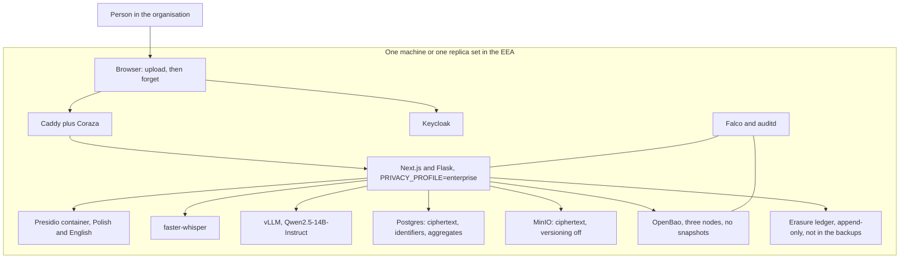

# Target architecture

> **Proposal. Not in force.** A separate deployment for one client. The public WillpowerLab loop, its processors, and its seven-day deletion window stay as they are when `PRIVACY_PROFILE` is unset. This page is the design that [04-audit-rounds.md](04-audit-rounds.md) was willing to pass. It assumes the research in [02-research.md](02-research.md).

## What this deployment is for

The client is the controller. The data is their organisation's audio and the transcripts of it: meetings and conversations they upload, not a microphone left running in a room. The purpose is pattern spotting (themes, repeated blockers, how a conversation moves), produced as aggregates that do not name a person, plus a per-person view that only that person, or a role the controller has named, can open.

WillpowerLab's public coaching product is a different controller relationship (Artur Willoński as controller of speakers' Takes). This deployment does not reuse that database, that Supabase project, that R2 account, or that OpenAI key. Code is shared. Data is not.

Two ways to run it:

| Mode | Who operates the machine | Who is processor of the content |
|---|---|---|
| **A. Client-hosted** (preferred) | The client, on hardware they control, in the EEA | Nobody, if the developer has no access to content. A support contract that includes SSH is a processor relationship and needs a DPA and a break-glass procedure. |
| **B. Dedicated EU host** | WillpowerLab, on one Hetzner dedicated server in Germany or Finland, one client only | Artur Willoński / WillpowerLab, under a DPA. Hetzner is the only sub-processor. |

Mode A is the one that makes the sub-processor list empty. Mode B is the one that exists when the client will not run a server. Both use the same software profile.

## Diagram

Outbound internet from this box is denied after the images are built. Inbound is 443 to Caddy only. Postgres, MinIO, OpenBao, the model, the recogniser and Keycloak listen on a private interface.

## Components

| Component | Role | Notes |
|---|---|---|
| Caddy | TLS termination, request size limits | Its own CA or a publicly trusted certificate. Not Cloudflare. |
| Coraza | OWASP core rule set in front of the app | Blocks obvious injection. Does not inspect decrypted audio. |
| Next.js | The existing frontend, served from this host | No Vercel. The enterprise build strips the OpenAI websocket and the IndexedDB outbox. |
| Flask | The existing backend, same profile flag | Refuses to boot if a forbidden processor is configured. See the boot list below. |
| faster-whisper behind an OpenAI-compatible HTTP API | Transcription | CPU by default. Word timestamps, so the current segment shape can be kept. |
| Presidio container | Redaction | `pl_core_news_lg` and `en_core_web_lg`, Polish label map, checksum recognisers. GPL model stays in this container. |
| vLLM | Pattern spotting and any coaching-style text the client still wants | OpenAI-compatible. Inference only. |
| Postgres 17 | Rows | Self-hosted. Supabase Docker's PostgREST is allowed so `services/db.py` does not have to be rewritten. GoTrue is not used. |
| MinIO | Audio and file objects | S3 API, so the R2 client changes endpoint and nothing else. Versioning off. |
| OpenBao | Per-person keys, the service credential, unseal | Hard-delete only. No snapshot job. |
| Erasure ledger | The list of destroyed key ids and the time | A separate append-only file or a small disk that backups do not include. Checked at every process start. |
| Keycloak | The client's identity | OIDC. MFA required. No Google, LinkedIn, Apple, or WhatsApp on this profile. |
| Falco, auditd | Runtime detection | Alerts stay on the box, reviewed by the operator. |

### Boot refusal

`PRIVACY_PROFILE=enterprise` exits before serving if any of the following are set or reachable: `OPENAI_API_KEY`, `MISTRAL_API_KEY`, `ELEVENLABS_API_KEY`, `RESEND_API_KEY`, `SENTRY_DSN`, a Supabase URL that is not on the local network, an S3 endpoint that is not the local MinIO, `WHATSAPP_*` tokens, a Stripe secret, `NEXT_PUBLIC` configuration that would send the browser to `api.openai.com`. Training surfaces, the life-panel upload, guest owners, and the public journal image generator are off. A missing OpenBao, a missing Presidio, or a missing erasure ledger is also a refusal. The public product does not set the variable, so none of these checks run there.

## Two stores, and what is allowed to be personal

| Store | Contents | Key | Still personal data? |
|---|---|---|---|
| Content store | Audio, raw transcript, the person's own Ideal Text if the client uses that feature, the redaction map if reversible tokens are switched on | That person's DEK | Yes. Shown back only to the person and to roles the controller named. Never sent to the model. |
| Analysis store | Text after irreversible redaction, plus features that are not a voiceprint (pace, turn length, who-spoke-when inside one meeting as `SPEAKER_1`) | The same DEK, so erasure blinds the backup | Yes. Pseudonymised. Treated as personal data. The model reads it inside the box and the prompt is not logged. |
| Aggregate store | Counts and themes, cell size at least 5, no time series that would let a reader subtract one deletion and see the person | None. Recomputed from the analysis store. Not kept as microdata. | No, if the three EDPB tests hold for that output. A cell under 5 is not written. |
| Accountability store | The fact of a consent, the fact of a deletion, security events | Subject identifiers in the access log are encrypted with the person's DEK | The encrypted identifier dies with the key. What remains is time, action, component. Consent *evidence* that the law requires the controller to keep is a row the controller decides, and it must not contain a transcript. |

Voice embeddings, speaker-identification models, and cross-meeting voiceprints are not computed. Diarisation labels exist for one recording and are not a biometric template. Frame-level acoustic detail is reduced to a few numbers per meeting and stored in the analysis store under the same key. `services/part_acoustics.py` and the measurement columns on `recordings` are the current code this replaces for this profile; the public product's measurements are untouched.

## Ingest

1. The browser records or selects a file and uploads it over TLS to this host. It does not write IndexedDB. It does not open a socket to a model host. A failed upload is retried from memory for the life of the page, not from a seven-day outbox.
2. The app generates a DEK in OpenBao named for the person and the object, encrypts the bytes with AES-256-GCM, and writes the ciphertext to MinIO. Plaintext audio is not written to Postgres and not written to a disk temp file. The scratch space is a tmpfs.
3. The worker decrypts into tmpfs, runs faster-whisper, and wipes the tmpfs. The raw transcript is encrypted with the same DEK and stored. That copy is what the person can read back. It is not what the model reads.
4. Presidio runs on the transcript, Polish or English as the recogniser's language detection, or both when the recording mixes them. Checksum recognisers run regardless of language.
5. Any span scored as a person, an organisation the client has asked to hide, an email, a phone, a PESEL, a NIP, a REGON, an IBAN, or a precise date of birth is replaced with a typed marker (`[PERSON]`, `[PESEL]`). A token the Polish model is unsure about, and any capitalised span the two recognisers disagree on, becomes `[REDACTED-UNSURE]` and that sentence is not sent to the model at all.
6. The redacted text is encrypted with the DEK and stored in the analysis store. vLLM is called with that text only. The prompt template tells the model to refuse to invent a name that is not in the input, and to return themes and counts. The response is checked for strings that look like the markers had been reversed (an email regex, a PESEL checksum). A response that contains one is dropped, not stored.
7. Aggregates are computed from the redacted store for groups of at least five people. Smaller groups produce no row.

The person's own screen can show their own raw transcript, because that is their data, not an analysis of someone else. That read decrypts with their key and is authorised in the application. It is the same boundary the coaching product already has between a speaker and a coach, kept, and with the model moved to the redacted side.

## Deletion

A request is carried out when it is received. There is no seven-day undo on this profile. The public product's window is a founder decision (`services/account_deletion.py` lines 1–10) and stays for the public product.

Order of operations, and the order is the control:

1. Append the key id, the person, and the time to the erasure ledger. If this write fails, stop. Nothing else happens.
2. Hard-delete the DEK in OpenBao (`deletion_allowed`, then `DELETE`, not the soft-delete endpoint). Confirm a decrypt call fails.
3. Delete the live ciphertext in MinIO and the live rows in Postgres, using the existing purge graph in `services/data_purge.py` for the tables it already knows, plus the analysis rows. Byte-hash checks stay.
4. Write the result next to the ledger line: live delete done, key destroy done.
5. Return to the person. From this moment a backup of the database or of MinIO cannot be read, because the key is gone and is not in the backup.

Before the app serves after any restart or restore:

- Read the ledger.
- For every line, confirm the key is absent and the live rows are absent.
- If a key is present, delete it again and refuse to serve until that succeeds.

Backups of Postgres and MinIO are ciphertext, taken on a schedule the client chooses for ransomware recovery (the suggestion is seven days, because the keys are not in them). They can be longer without reopening Article 17 for the content, provided nobody starts snapshotting OpenBao "to match". The DPIA states the residual: ciphertext remains on backup media until that media expires, it is unreadable without the key, and the key is not on that media. Counsel decides whether to describe that residual as personal data that is beyond use. The software does not decide it.

What deletion does not promise:

- A copy the person already downloaded.
- Aggregates that do not single them out. Those are recomputed; a cell that drops below five disappears on the next computation. Old published reports that were already non-identifying are not personal data and are not rewritten. The differencing defence is the cell size plus not storing a fine-grained time series.
- The controller's legal hold, if a real one exists. A hold is a row in the ledger that delays step 2, and it requires a named human and an expiry. The software does not invent holds. Workplace audio should almost never be under a hold; if it is, the client records why under Article 17(3).

IP addresses in the edge log are kept 14 days and then deleted. They are not the conversation. An erasure request deletes that person's live edge lines the same day; the edge log is not in the content backup. Access-log identifiers are under the DEK, so step 2 blinds them.

## Key management

- One OpenBao transit or KV key per person, created at first upload, hard-deleted on erasure.
- DEKs are not exportable. The application asks OpenBao to decrypt a wrapped DEK, or receives a DEK over the local socket and wipes it. No DEK in an environment variable, a core dump (core dumps off), or a log.
- Unseal shares: two of three, held by two officers of the client and a sealed offline share in the client's safe. The developer does not hold a share in mode A. In mode B the developer holds none of the content keys; unseal shares are still the client's, so WillpowerLab cannot read a restored disk alone.
- LUKS on every data volume, including OpenBao's.
- No OpenBao snapshot, no MinIO versioning, no Postgres PITR that includes key material (it cannot include it if keys were never in Postgres).
- Rotation of a DEK re-encrypts that person's objects. Rotation is not erasure. Erasure is deletion of the key without re-encryption.
- The service-role credential that PostgREST uses is a secret in OpenBao, injected at process start, and is not the content key. Stealing it yields ciphertext.

Availability: three OpenBao nodes on the same site, Raft. Loss of the whole site loses the ability to read existing ciphertext. That is written into the recovery objective on purpose. RPO for *destroyed* keys is "never recovered". RPO for *living* keys is "the replicas". RPO for ciphertext is the backup interval, which is useless without the key and therefore does not resurrect a deleted person.

## Hosting and residency

All of the boxes above run in the EEA. Mode B names Hetzner Germany or Finland at order time and records the site in the ROPA. DNS may be hosted anywhere. Mail, if the client insists on mail, is a local relay that sends a notice with no transcript in the body ("a report is ready") and nothing else. Resend is not configured. There is no Sentry. Errors stay in the local journal, 14 days, with the same scrubbing rule as the application log: no message body, no model output, no transcript fragment.

The application log in this profile does not include `raw_head`, exception strings from the model client, or the user id in clear text. It includes a request id, a surface name, a status, and a duration. That is a code change listed in [05-implementation-plan.md](05-implementation-plan.md), aimed at `services/llm.py` lines 254–258 and 326–330.

Postgres is started with `log_statement=ddl` (not `all` or `mod`) and PostgREST is started without request-body logging. Otherwise the database's own log becomes a second copy of whatever a statement contained, which would put a plaintext bug, or a large ciphertext, into journald. MinIO access logs record the object key and the result, not the body.

## What is reused from the current code

| Current piece | Use in this deployment |
|---|---|
| `services/data_purge.py` and the registry | The live-row deletion in step 3, for the tables a person actually has. Enterprise adds the analysis tables and runs without the seven-day wait. |
| `services/authorized_provider.py` | Kept. The only permitted provider names are `local-whisper` and `local-llm`. |
| `services/llm.py` and `services/chat_provider.py` | The chat client, pointed at vLLM's base URL. The Mistral and OpenAI branches are dead code under the boot check. |
| `services/openai_service.py` | The request shape (verbose JSON, segments, words), pointed at local faster-whisper. |
| `services/r2_client.py` | Endpoint changed to MinIO. Public URL helpers are not called; the boot check fails if a public base URL is set. |
| `services/user_content_keys.py` | Still the rule that user content is never a public URL. On this profile every key is user content, including decks. |
| Private-bucket work in `docs/PRIVATE-BUCKETS-M11.4.md` | Already the right idea. MinIO makes it the only idea. |
| Sentry's `send_default_pii=False` | Irrelevant here, because Sentry is absent. The discipline (do not put the body in the error) stays. |
| Coach blind review | Not part of this deployment unless the client asks for a human reviewer. A human reviewer is a new recipient and a new DPIA line. The model is not a shortcut around that. |

## What a speaker of the public product notices

Nothing. The flag is off. Railway, Supabase, OpenAI, the seven-day window, the signed privacy text, and the Ideal Text loop are unchanged. Building this deployment is a new environment and a set of guarded code paths, not a migration of production data.
